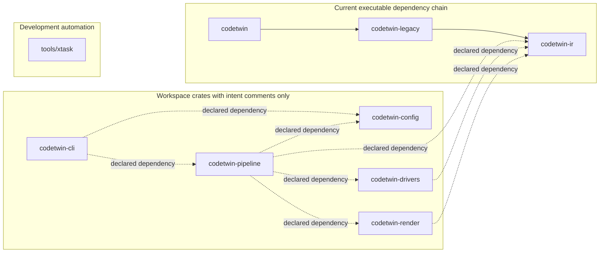
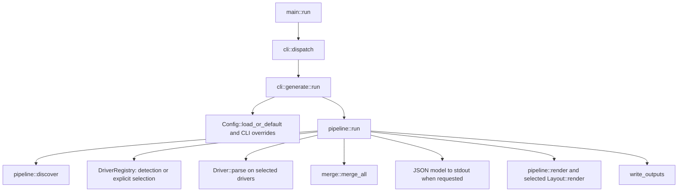

# CodeTwin's first dogfood target

Dogfooding is the agreed first use case. This is a hand-written reference assembled from the
current manifests and source at `9c41fbc`, not output generated by CodeTwin. The presentation
below records the original overview and detail proposal. The subsequent workspace slice uses
`inspect` and `visualize`; see [the generated current overview](code/index.md). The graph below
is historical: the primary crate now also depends directly on `codetwin-ir` and owns the new CLI,
workspace analysis and Markdown generation. Deeper source views remain a target.

The first workspace-level slice and its test outcomes are specified in
[the implementation plan](IMPLEMENTATION_PLAN.md).

## Repository Overview

The first view should answer: where does CodeTwin's executable behavior live, what does it
depend on, and which workspace crates are still scaffolds?

Arrows point from a dependent crate to its dependency. Dashed arrows belong to scaffold crates
outside the current executable's dependency chain. All arrows describe declared local Cargo
dependencies; the grouping additionally reflects the current source implementation.
Development automation is a workspace member but is not part of the shipped executable.

| Component | What the developer should learn | Source |
| --- | --- | --- |
| `codetwin` | Parses arguments, configures tracing and dispatches commands | [main.rs](../crates/codetwin/src/main.rs) |
| `codetwin-legacy` | Owns today's CLI, configuration, analysis orchestration and output | [lib.rs](../crates/codetwin-legacy/src/lib.rs) |
| `codetwin-ir` | Owns the language-neutral modules, symbols and relationships | [model](../crates/codetwin-ir/src/ir/) |
| Five scaffold crates | Declare a proposed decomposition but have no implementation yet | [workspace index](../crates/README.md) |
| `tools/xtask` | Checks and scaffolds the repository; does not implement code visualization | [entrypoint](../tools/xtask/src/main.rs) |

## Detail View: generation

A useful first drill-down follows the `gen` handler into its directly called code:

These arrows show static caller relationships and conditional branches, not a runtime trace.
JSON model output bypasses rendering and writing. The ordinary path renders and writes.
Watch mode wraps repeated execution of the same pipeline.

Source anchors: [dispatch](../crates/codetwin-legacy/src/cli/mod.rs),
[generation](../crates/codetwin-legacy/src/cli/generate.rs),
[pipeline](../crates/codetwin-legacy/src/pipeline/mod.rs),
[discovery](../crates/codetwin-legacy/src/pipeline/discover.rs),
[drivers](../crates/codetwin-legacy/src/drivers/),
[layouts](../crates/codetwin-legacy/src/layouts/),
[writing](../crates/codetwin-legacy/src/pipeline/write.rs).

The view should make incomplete behavior visible: drivers currently return empty models;
the two primary layouts are placeholders. Unsupported extraction must not look like successful
analysis of a repository with no dependencies. Recognizing a TODO is useful evidence; a tool
must not infer complete implementation status merely from an empty output.

## What counts as progress

1. Inventory the actual workspace from manifests, including crates outside the executable's
   dependency chain. Draw the correct local dependency edges and show source links.
2. Expand a component into its modules and declared symbols. Identify relationships with
   source evidence, keeping unresolved relationships explicit.
3. Produce a Markdown overview with links to generated detail views. Verify every generated
   link and show components even when they have no dependency edges.
4. Re-run on the unchanged repository and obtain byte-identical artifacts. Avoid timestamps
   and machine-specific paths in those artifacts.
5. Change a small fixture's dependency or module, regenerate, and verify the visualization
   reflects that change. Dogfooding should follow source changes rather than preserve this
   reference's current crate count or names forever.

The first implementation can deliver the workspace inventory before the deeper source view.
Fixtures provide precise automated checks; running on CodeTwin provides the real usability
check. Optional later CI automation can regenerate and validate the artifacts once generation
is meaningful. This document does not add that automation or change the executable.
