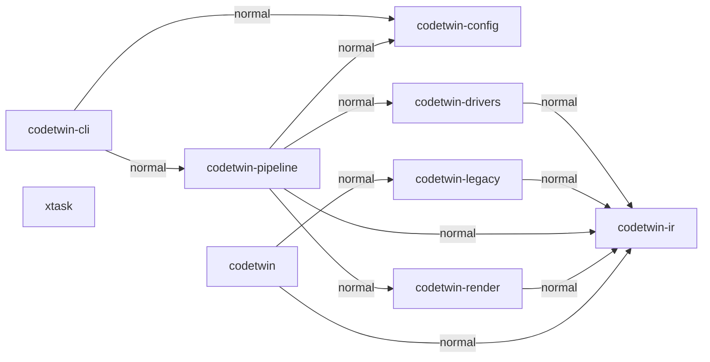

<!-- Generated by CodeTwin. -->

# Repository Overview

Rust workspace: 9 packages.

## Packages

| Package | Targets | Manifest |
| --- | --- | --- |
| [codetwin-cli](crates/p6372617465732f636f64657477696e2d636c692f436172676f2e746f6d6c.md) | lib | [crates/codetwin-cli/Cargo.toml](../../crates/codetwin-cli/Cargo.toml) |
| [codetwin-config](crates/p6372617465732f636f64657477696e2d636f6e6669672f436172676f2e746f6d6c.md) | lib | [crates/codetwin-config/Cargo.toml](../../crates/codetwin-config/Cargo.toml) |
| [codetwin-drivers](crates/p6372617465732f636f64657477696e2d647269766572732f436172676f2e746f6d6c.md) | lib | [crates/codetwin-drivers/Cargo.toml](../../crates/codetwin-drivers/Cargo.toml) |
| [codetwin-ir](crates/p6372617465732f636f64657477696e2d69722f436172676f2e746f6d6c.md) | lib, test | [crates/codetwin-ir/Cargo.toml](../../crates/codetwin-ir/Cargo.toml) |
| [codetwin-legacy](crates/p6372617465732f636f64657477696e2d6c65676163792f436172676f2e746f6d6c.md) | lib, test | [crates/codetwin-legacy/Cargo.toml](../../crates/codetwin-legacy/Cargo.toml) |
| [codetwin-pipeline](crates/p6372617465732f636f64657477696e2d706970656c696e652f436172676f2e746f6d6c.md) | lib | [crates/codetwin-pipeline/Cargo.toml](../../crates/codetwin-pipeline/Cargo.toml) |
| [codetwin-render](crates/p6372617465732f636f64657477696e2d72656e6465722f436172676f2e746f6d6c.md) | lib | [crates/codetwin-render/Cargo.toml](../../crates/codetwin-render/Cargo.toml) |
| [codetwin](crates/p6372617465732f636f64657477696e2f436172676f2e746f6d6c.md) | bin, lib, test | [crates/codetwin/Cargo.toml](../../crates/codetwin/Cargo.toml) |
| [xtask](crates/p746f6f6c732f787461736b2f436172676f2e746f6d6c.md) | bin, test | [tools/xtask/Cargo.toml](../../tools/xtask/Cargo.toml) |

## Declared local dependencies

Arrows point from a dependent package to its dependency. Optional and conditional declarations are not evaluated. This is not a runtime call graph.

